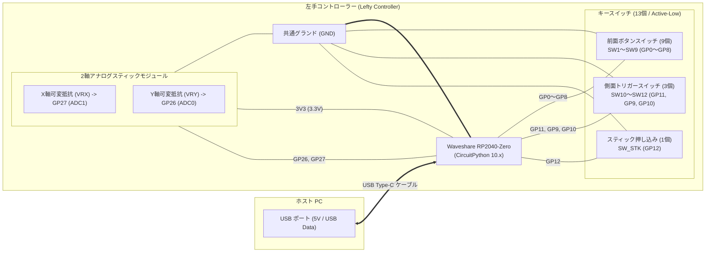

# 左手デバイス ハードウェア回路図 & 配線仕様書

本ドキュメントでは、**Waveshare RP2040-Zero** を用いた左手コントローラーの電気回路図、ピン配線例、および製作・換装時の注意点を解説します。

---

## 1. 回路設計コンセプト

1. **外付けプルアップ抵抗レス（内蔵プルアップ活用）**
   - RP2040の全GPIOに備わっているソフトウェア制御の**内蔵プルアップ抵抗（Software Pull-up: 約50kΩ〜80kΩ）**をファームウェアで有効化しています。
   - 基板上の外付け集合抵抗は不要で、各スイッチの片側をGPIO、もう片側を共通GND（グランド）に落とすだけの**Active-Low（押下時GND短絡）**接続です。
2. **3.3V電源の厳守（ADC過電圧保護）**
   - RP2040のADC（アナログ入力）は **最大3.3V（絶対定格 3.63V）** です。
   - アナログスティックの電源端子（VCC）には、必ず RP2040-Zero の **`3V3`（3.3V出力ピン）** を接続してください。**5V（VBUS）を接続するとマイコンが破損します。**
3. **ソフトウェアによるキャリブレーション・回転補正**
   - スティックの取り付け向きやポテンショメータの公差は、WebUI上の「回転（0°/90°/180°/270°）」「X/Y軸反転」「デッドゾーン・中心キャリブレーション」で自由に補正できるため、ハードウェア側の物理的な取り付け方向に縛られず配線できます。

---

## 2. 全体ブロック図



---

## 3. 回路接続図 (Schematic Wiring Diagram)

```text
               +-------------------------------------------+
               |        Waveshare RP2040-Zero              |
               |                                           |
               |             +---+ USB-C +---+             |
               |             |               |             |
 (USB 5V/VBUS) | 5V          +---------------+         GND | ---+ (共通GNDへ)
               | GND                                  GP15 |
               | 3V3 ------------------------+        GP14 |
               | GP0 --------[ SW1 (1) ]----+ |       GP13 |
               | GP1 --------[ SW2 (2) ]----+ |       GP12 | ---[ SW_STK (スティック押込) ]---+
               | GP2 --------[ SW3 (X) ]----+ |       GP11 | ---[ SW10 (側面上トリガー) ]-----+
               | GP3 --------[ SW4 (E) ]----+ |       GP10 | ---[ SW12 (側面下トリガー) ]-----+
               | GP4 --------[ SW5 (Ta) ]---+ |        GP9 | ---[ SW11 (側面中トリガー) ]-----+
               | GP5 --------[ SW6 (F) ]----+ |        GP8 | ---[ SW9 (3) ]-------------------+
               |                            | |        GP7 | ---[ SW8 (4) ]-------------------+
               | [裏面パッド/端子]           | |        GP6 | ---[ SW7 (Q) ]-------------------+
               | GP26 (ADC0) --+            | |            |                                  |
               | GP27 (ADC1) -+|            | |            +----------------------------------+
               +--------------||------------+-|-----------------------------+
                              ||            | |                             |
                              ||            | |                             |
           +------------------||------------+ |                             |
           |                  ||              |                             |
           |   2軸アナログ    ||              |                             |
           |   スティック     ||              |                             |
           |  +-------------+ ||              |                             |
           |  | VCC         | <+ (3.3V)       |                             |
           |  | GND         | <---------------+=============================+ (共通グランドライン)
           +> | VRX (X軸)   | (0〜3.3V アナログ電圧)                        |
            > | VRY (Y軸)   | (0〜3.3V アナログ電圧)                        |
              | SW (押込)   | ----------------------------------------------+
              +-------------+
```

> [!IMPORTANT]
> **GP0 (SW1) はメンテナンスモードの起動検知ピンです:**
> GP0 を押したまま USB ケーブルを接続すると、`boot.py` がこれを検知して PC に `CIRCUITPY` ドライブをマウントします。通常起動時は押さずに接続してください。

---

## 4. ピン接続・端子対応一覧表

| RP2040-Zero 端子 | 接続先デバイス | 役割・機能 | 回路動作仕様 | 配線推奨色 (例) |
| :--- | :--- | :--- | :--- | :--- |
| **5V** | - | USBバスパワー受電 (未使用または外部電源時) | 通常は未配線 (USB-C給電) | 赤 |
| **3V3** | アナログスティック VCC | スティック用 3.3V 電源供給 | 出力 (Max 300mA) ※5V厳禁 | 橙 / 赤 |
| **GND** | スイッチ全13個コモン / スティック GND | 共通グランド | 0V | 黒 / 青 |
| **GP0** | 前面 SW1 (`1`) | ボタン1 / メンテナンスモード判定 | 内部プルアップ / Active Low | 白 |
| **GP1** | 前面 SW2 (`2`) | ボタン2 | 内部プルアップ / Active Low | 白 |
| **GP2** | 前面 SW3 (`X`) | ボタン3 | 内部プルアップ / Active Low | 白 |
| **GP3** | 前面 SW4 (`E`) | ボタン4 | 内部プルアップ / Active Low | 白 |
| **GP4** | 前面 SW5 (`Ta`) | ボタン5 (Tab) | 内部プルアップ / Active Low | 白 |
| **GP5** | 前面 SW6 (`F`) | ボタン6 | 内部プルアップ / Active Low | 白 |
| **GP6** | 前面 SW7 (`Q`) | ボタン7 | 内部プルアップ / Active Low | 白 |
| **GP7** | 前面 SW8 (`4`) | ボタン8 | 内部プルアップ / Active Low | 白 |
| **GP8** | 前面 SW9 (`3`) | ボタン9 | 内部プルアップ / Active Low | 白 |
| **GP9** | 側面 SW11 (`側面中`) | トリガー2 (中段) | 内部プルアップ / Active Low | 黄 |
| **GP10** | 側面 SW12 (`側面下`) | トリガー3 (下段) | 内部プルアップ / Active Low | 黄 |
| **GP11** | 側面 SW10 (`側面上`) | トリガー1 (上段) | 内部プルアップ / Active Low | 黄 |
| **GP12** | スティック SW_STK (`STK`)| スティック押し込みスイッチ | 内部プルアップ / Active Low | 緑 |
| **GP26** | スティック Y軸 (VRY) | アナログ Y 軸入力 (ADC0) | 0.0V 〜 3.3V (16bit読取) | 緑 |
| **GP27** | スティック X軸 (VRX) | アナログ X 軸入力 (ADC1) | 0.0V 〜 3.3V (16bit読取) | 青 |

> [!NOTE]
> **側面上中下のピン順序（GP11, GP9, GP10）について:**  
> 既存基板の配線パターンおよびユニバーサル基板での引き回しにおいて、配線の交差を最小限に抑えるため上記のアサインになっています。WebUI 上では「側面上 (SW10)」「側面中 (SW11)」「側面下 (SW12)」として自然な順番で表示されます。

---

## 5. 部品選定と配線のポイント

### 5.1 アナログスティック
- **推奨部品:**
  - PS2/Xbox互換 アナログサムスティックモジュール (10kΩ 2軸ポテンショメータ + 押し込みスイッチ)
  - アルプスアルパイン RKJXV / RKJXK シリーズ
- **配線時の注意:**
  - 可変抵抗の抵抗値は 10kΩ 程度が最適です（極端に低いと消費電力が増加し、高すぎるとADCサンプリングのノイズ耐性が下がります）。
  - ノイズが気になる場合は、GP26・GP27 と GND 間に **0.1µF (104) の積層セラミックコンデンサ** を並列に入れると、より安定したアナログ値が得られます（通常はファームウェア側のデッドゾーンとヒステリシスで十分安定します）。

### 5.2 スイッチ配線 (GNDデイジーチェーン)
- スイッチ全13個の片側ピンは、すべて共通の GND（0V）に接続します。
- スイッチ同士の GND 端子を**数珠つなぎ（デイジーチェーン）**で配線することで、マイコン基板へ戻す GND 線を 1〜2 本に集約でき、配線束をすっきりまとめられます。

### 5.3 既存機（PIC18F2450等）からの改造・換装時のチェックリスト
- [ ] **旧マイコンの撤去:** PIC18F2450 などの旧マイコンおよびソケットを取り外します。
- [ ] **5V電源ラインの遮断:** 旧回路の 5V 電源がスティックの VCC に繋がっていないかテスターで確認し、RP2040 の `3V3` からのみ給電します。
- [ ] **旧プルアップ集合抵抗の撤去:** 基板上に 10kΩ などの集合抵抗が残っていると、5Vラインにプルアップされて GPIO に過電圧がかかる危険があります。外付けプルアップ抵抗は取り外すかパターンをカットしてください。
- [ ] **GND共通接続の確認:** 全スイッチおよびスティックの GND が RP2040-Zero の GND と導通していることを確認します。
